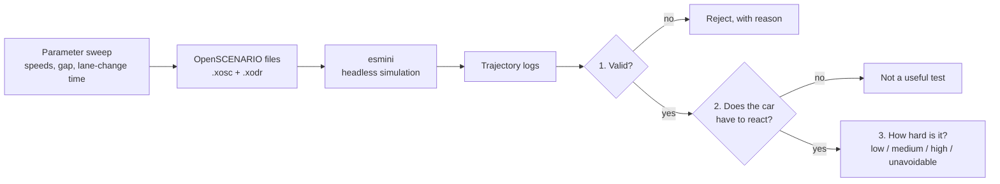
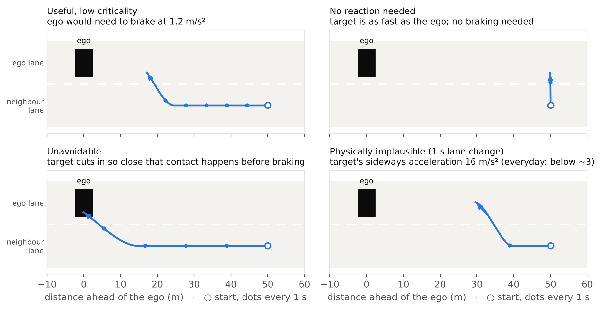

# Which simulated driving tests are worth running?

Automated driving functions are increasingly tested in simulation, using thousands of generated scenarios. But a generated scenario is not automatically a good test. This project checks each scenario automatically and shows how many good tests are left.

## In 30 seconds

- I generated **144 highway cut-in scenarios** (another car merges in front of you) as standard OpenSCENARIO files and ran them in the esmini simulator.
- **Only 9 of them are distinct, valid tests that a car could pass.** The rest never trigger the cut-in, move in physically impossible ways, need no reaction, cannot be passed by any car, or repeat another test.
- **The checker is itself tested.** I injected 6 typical scenario bugs into 57 scenarios. It caught 340 of the 342 broken files; the 2 misses are unit errors that happen to produce realistic speeds.


## How it works



The three questions are asked in order. Each verdict comes with the reason, so a test engineer can fix the scenario instead of just dropping it.

## What the checks found


*Each cell is one scenario. Grey cells are invalid, blue cells are useful tests (darker means harder), red cells cannot be passed by any car.*

1. **A third of the sweep never does anything.** If the merging car is as fast as you or faster, the gap never shrinks, so the cut-in is never triggered (T).
2. **A 1-second lane change is never realistic.** It needs 14 to 18 m/s² of sideways acceleration; everyday lane changes typically stay below about 3 (P).
3. **Your own speed barely matters here.** The three horizontal blocks (80, 100, 120 km/h) look the same, because how hard you have to brake depends on the speed difference and the gap. Two thirds of the useful tests are near-copies.
4. **A slower lane change can be more dangerous.** The merging car reaches your lane later, and therefore closer.



## Testing the checker

A checker is only useful if it catches real bugs. I injected each bug below into all 57 scenarios that passed the checks, and counted how often the result was rejected.

| Injected bug | What it imitates | Caught |
|---|---|---|
| Spawn overlap | the two cars start inside each other | 57 / 57 |
| Off road | a car starts next to the road | 57 / 57 |
| Teleport | a car jumps 30 m forward | 57 / 57 |
| Snap lane change | a lane change in 0.3 s | 57 / 57 |
| Dead trigger | the cut-in condition can never be met | 57 / 57 |
| Unit error | a speed written in km/h instead of m/s | 55 / 57 |

The 2 missed unit errors turned 40 km/h into 144 km/h, which is still a realistic highway speed. Such bugs cannot be caught by physics checks alone.

I also checked the other direction: 3 scenarios that I expected to be fine were rejected. In all 3 the car is already next to you when it starts to merge, so the planned cut-in cannot happen. The checker was right and my expectation was wrong.

## Why this matters

Simulation-based validation runs many scenarios, and each run costs compute and review time. Invalid or redundant scenarios also make coverage numbers look better than they are. The same checks apply whether scenarios are written by hand, found by search, or generated by an LLM.

## Honest limits

- One scenario type (cut-in) on a straight road, in one simulator (esmini).
- The limits (for example 5 m/s² sideways, 0.5 s reaction time) are reasonable defaults, not calibrated on real driving data.
- Difficulty is measured for the scenario, not for a specific driving function: the ego drives at constant speed, and I compute how hard it would have to brake after a 0.5 s reaction time.
- "Near-copy" means same speed difference, gap and lane-change time. A real driving function might behave differently at 80 and 120 km/h.

## Next steps

- Run the same files in CARLA (ScenarioRunner) and check whether the verdicts agree across simulators.
- More scenario types and real road networks (OpenDRIVE maps).
- Let an LLM write scenarios from text descriptions and measure how many pass these checks.

## Run it

```bash
pip install -r requirements.txt
bash scripts/get_esmini.sh                                         # esmini for Linux x86-64
ESMINI_BIN=esmini/bin/esmini python scripts/pipeline.py --out outputs
python scripts/report.py --out outputs --docs docs
pytest -q
```

Details: [technical report](docs/TECHNICAL.md). Built on [esmini](https://github.com/esmini/esmini), [scenariogeneration](https://github.com/pyoscx/scenariogeneration) and ASAM OpenSCENARIO / OpenDRIVE. Results in `reports/`.

Author: Haoxiang Gao
