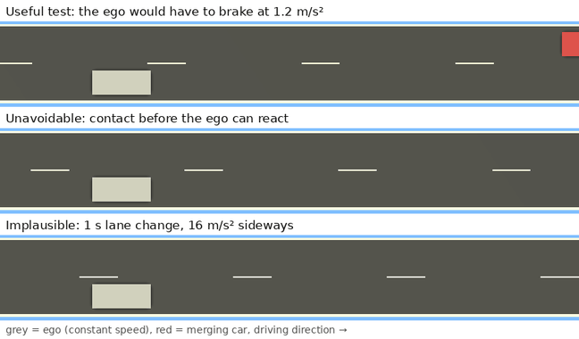
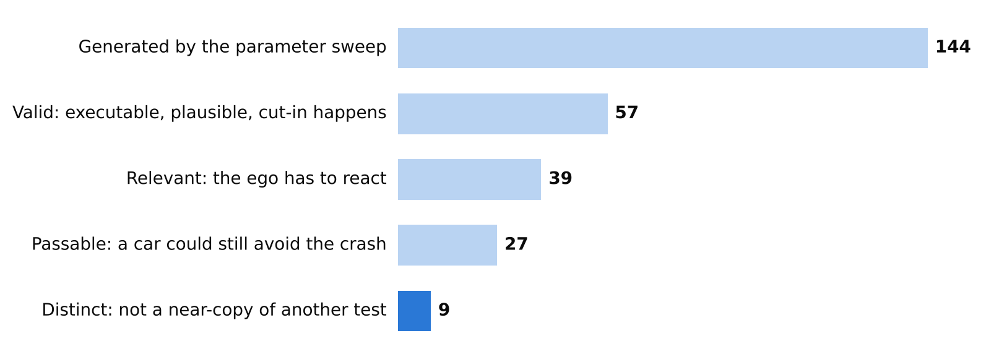
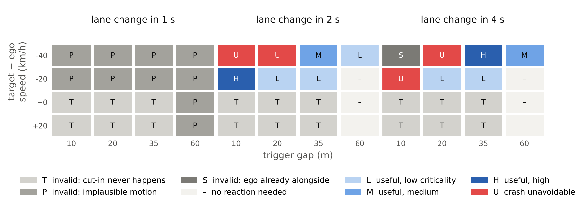

# scenario-quality

How many scenarios from a parameter sweep are actually useful as simulation tests?

I generated 144 highway cut-ins (a car merges into the ego lane) as OpenSCENARIO files, ran them in [esmini](https://github.com/esmini/esmini) and checked each run:

1. Valid: it runs, starts consistently, moves plausibly, and the cut-in actually happens.
2. Relevant: the ego has to react.
3. Criticality: how hard the ego would have to brake after a 0.5 s reaction time.



## Results

57 of 144 are valid, 39 need a reaction, 27 are still passable, and only 9 of those are not near-duplicates.





Shown for an ego speed of 100 km/h. The verdicts are identical at 80 and 120 km/h, which is why so many scenarios are near-duplicates.

Things I did not expect:

- 54 scenarios never trigger the cut-in. The trigger is "gap below X m", and if the other car is not slower than the ego, the gap never shrinks.
- All 1 s lane changes are implausible (14 to 18 m/s² lateral acceleration).
- A slower lane change makes the cut-in more critical, not less: the car enters the lane later, when the gap is already smaller.

## Does the checker catch bugs?

I took the 57 scenarios that passed and broke each of them in six ways:

| Bug | Caught |
|---|---|
| cars spawned inside each other | 57 / 57 |
| car spawned off the road | 57 / 57 |
| car teleports 30 m | 57 / 57 |
| lane change in 0.3 s | 57 / 57 |
| trigger that can never fire | 57 / 57 |
| speed written in km/h instead of m/s | 55 / 57 |

The two misses are unit errors where 40 km/h became 144 km/h. That is still a normal highway speed, so a physics check cannot see it.

## How sensitive is this to my thresholds?

Changing one threshold at a time (reaction time, lateral acceleration limit, relevance criterion, max braking) gives between 4 and 15 distinct tests instead of 9. The lateral acceleration limit matters most, because it decides whether 2 s lane changes (about 4 m/s²) count as plausible. Full table in [docs/TECHNICAL.md](docs/TECHNICAL.md#44-sensitivity).

## Notes

- My first version drove the ego with esmini's ACC controller. It braked from 100 km/h to under 10 km/h in about one second, which is physically impossible, so I switched to a constant-speed ego and compute the required braking instead. This rates the scenario, not a driving function.
- Three scenarios I expected to be fine were rejected. In those, the ego is already next to the other car when it starts to merge, so the checker was right.
- One manoeuvre, straight road, one simulator. Thresholds are defaults, not calibrated on real driving data.

Next: run the same files in CARLA ScenarioRunner to see whether the verdicts agree, and check scenarios written by an LLM.

## Usage

```bash
pip install -r requirements.txt
bash scripts/get_esmini.sh          # downloads esmini (Linux x86-64)
ESMINI_BIN=esmini/bin/esmini python scripts/pipeline.py --out outputs
python scripts/report.py --out outputs --docs docs
python scripts/sensitivity.py --out outputs
pytest -q
```

The GIF is made with `xvfb-run -a -s "-screen 0 1280x720x24" python scripts/record_gif.py`. Per-scenario results are in `reports/`, details in [docs/TECHNICAL.md](docs/TECHNICAL.md).
